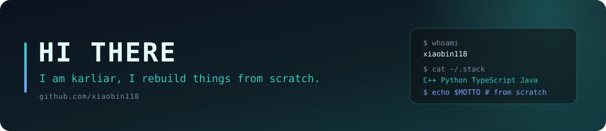

 

## ~ stack

## ~ stats

  <picture>
    <source media="(prefers-color-scheme: dark)" srcset="https://github-readme-stats.vercel.app/api?username=xiaobin118&show_icons=true&include_all_commits=true&hide_border=true&bg_color=00000000&title_color=39c5bb&icon_color=39c5bb&text_color=c9d1d9&rank_icon=github" />
    
  </picture>
  <picture>
    <source media="(prefers-color-scheme: dark)" srcset="https://streak-stats.demolab.com/?user=xiaobin118&mode=weekly&hide_border=true&background=00000000&ring=39c5bb&fire=bb9af7&currStreakNum=39c5bb&currStreakLabel=39c5bb&sideNums=c9d1d9&sideLabels=8b949e&dates=8b949e&stroke=30363d" />
    
  </picture>

  <picture>
    <source media="(prefers-color-scheme: dark)" srcset="https://github-readme-activity-graph.vercel.app/graph?username=xiaobin118&theme=github-compact&hide_border=true&bg_color=00000000&color=39c5bb&line=39c5bb&point=bb9af7&area=true" />
    
  </picture>

  <picture>
    <source media="(prefers-color-scheme: dark)" srcset="https://github-readme-stats.vercel.app/api/top-langs/?username=xiaobin118&layout=donut&langs_count=7&hide_border=true&bg_color=00000000&title_color=39c5bb&text_color=c9d1d9" />
    
  </picture>

## ~ projects

| repo | 是什么 | 技术 |
| [HIT_ML_Lab](https://github.com/xiaobin118/HIT_ML_Lab) | 机器学习课程实验：多项式/逻辑回归、k-means、GMM-EM、MLP 全部 NumPy 手写，另含 PyTorch CNN 与 DCGAN/VAE/DDPM | Python · NumPy · PyTorch |
| [windows-which-key](https://github.com/xiaobin118/windows-which-key) | 按住修饰键即列出当前应用可用快捷键的 Windows 桌面小工具 | Rust |
| [lilly-blog](https://github.com/xiaobin118/lilly-blog) | 基于 Astro 的静态博客，上面那些讲义与复盘都发在这儿 | Astro |
| [miku.nvim](https://github.com/xiaobin118/miku.nvim) | 写给 Miku 爱好者的 Neovim 配色 | Lua |
| [self-blog](https://github.com/xiaobin118/self-blog) | 自建动态博客，静态站的上游 | TypeScript |

 

from scratch, always.

<!--
可选增强（详见 SETUP.md 第 6 节）：
1. 贪吃蛇贡献图：启用 workflows/snake.yml 后，把下面这行的注释去掉
   
2. WakaTime 编码统计：建好账号、配好 secret 后，在 SETUP.md 第 6.2 节把那 6 行粘到「## ~ now」上面
-->
